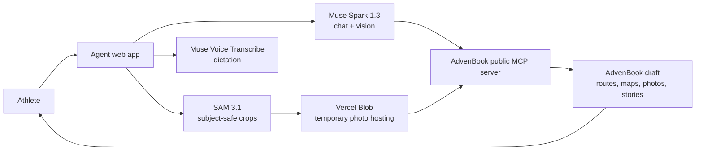

# AdvenBook Agent

Tell the agent what book you want — “My summer in the Pyrenees”, spoken or typed, in English or French.
It connects Strava (or takes your GPX files and photos), picks the outings with you, asks a few short questions, and creates a finished AdvenBook draft you open, edit, and order.
No sorting hundreds of activities, no blank-page writing: the agent does that work.

Demo video: _(placeholder — link added after recording)_

## How it works



Flow: describe the book → connect Strava (or drop GPX + photos) → the agent proposes a shortlist (races first, warm-ups unticked, standout outings badged) → optional 1–2 questions per outing become first-person stories → format/map/cover asked once, with real prices → one click creates the draft → **Open my book**.

## How we use Meta AI

**Muse Spark 1.3 — the art director.** It runs the whole conversation as a tool-calling agent over the AdvenBook MCP tools: it understands requests in the user's language, chooses which outings belong in the book and explains each pick in one line, interviews the athlete and turns answers into first-person stories without inventing facts, and makes design calls (format, cover, full-page heroes) from the data — photos count, race flag, elevation, route. The same model, with vision, also curates dropped photos: sharp, varied, no near-duplicates, one-line reason per keeper.

**SAM 3.1 — the careful cropper.** For every kept photo, SAM segments the main subject (“person”, “mountain summit”, “bicycle”…) from a text prompt; the app crops to a 3:2 print ratio around that box so nobody's head — or summit — gets cut. Without SAM these crops would be blind centre-crops.

**Muse Voice Transcribe — the empty-hands interview.** Athletes dictate the book request and their story answers instead of typing, in French or English; transcription lands in the input for a quick proofread before sending. Speech is where the memories are — typing them was the friction that made people abandon their book.

Model access is isolated in [lib/models.ts](lib/models.ts): provider, base URL, and model ids come from environment variables only, so the chat model can be swapped for any OpenAI-compatible endpoint without code changes.

## Setup

```bash
npm install
cp .env.example .env.local   # fill in the values below
npm run dev                  # http://localhost:3000
```

| Variable | Required | Purpose |
|---|---|---|
| `MODEL_API_KEY` | yes | Meta Model API key (server-only, never logged, never in client code) |
| `MODEL_BASE_URL` | no | Default `https://api.meta.ai/v1` |
| `CHAT_MODEL` | no | Default `muse-spark-1.3` |
| `VOICE_MODEL` | no | Default `muse-voice-transcribe-1.0` |
| `SAM_MODEL` | no | Default `sam-3.1` |
| `BLOB_READ_WRITE_TOKEN` | for photos | Vercel Blob store token; crops are uploaded as public photo URLs and deleted again once AdvenBook has copied them into the book |
| `ADVENBOOK_MCP_URL` | no | Default `https://www.advenbook.com/api/mcp` (public, no key) |

Deploy: any Next.js host (Vercel recommended). Set the same variables in the host's environment. No database: conversation state lives in the browser, Strava connection id in local storage.

## Project map

- [app/page.tsx](app/page.tsx) — one-page chat UI (brand charter applied: slate blue, patinated copper, Playfair Display + Inter, AdvenBook logos)
- [app/api/chat/route.ts](app/api/chat/route.ts) — agent endpoint; [lib/agent.ts](lib/agent.ts) — Muse Spark tool loop + book-creation safeguards
- [lib/mcp.ts](lib/mcp.ts) — AdvenBook MCP client (official SDK, tool definitions fetched at runtime, never rewritten)
- [lib/gpx.ts](lib/gpx.ts) · [lib/crop.ts](lib/crop.ts) · [lib/highlights.ts](lib/highlights.ts) — GPX parsing, subject-safe crops, standout-outing detection
- [test/](test/) — `npm test` (link rewriting, highlights, GPX, crop geometry)

## Licence

Proprietary — © AdvenBook, all rights reserved. This is a private repository: do not copy, distribute, or publish its contents. AdvenBook logos in [brand/](brand/) are trademarks of AdvenBook.
